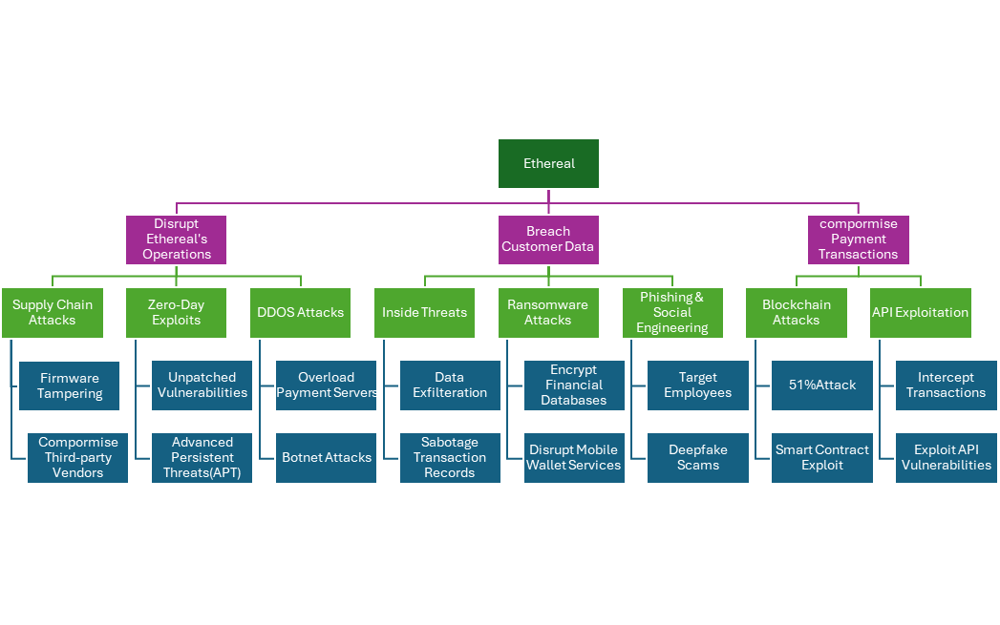

# Threat Model: Ethereal Inc. (Fintech)

> MSc Cyber Security coursework, Penetration Testing module, March 2025. Individual work.

**Skills shown:** threat modelling · attack trees · fintech/payment security · MITRE ATT&CK · security recommendations aligned with GDPR, PCI DSS and ISO 27001

---

## 1. The organisation

Ethereal Inc. is a **fictional** India-based company that provides digital payment services: mobile wallets, cross-border cryptocurrency transactions and AI-based fraud detection. It serves businesses and consumers, working with e-commerce platforms and financial institutions.

### Assumptions

**Industry and services**
- Operates in financial technology (fintech).
- Offers mobile wallet services and cross-border cryptocurrency transactions.
- Uses AI to detect and prevent payment fraud.

**Technology infrastructure**
- Cloud-hosted on Amazon Web Services and Microsoft Azure.
- Uses blockchain technology to record and secure transactions.
- Integrates with banks and e-commerce platforms through APIs.

**Threat profile**
- Likely adversaries: cybercriminals, nation-state actors and insiders.
- Key 2025 threats: ransomware, phishing, API abuse and AI-model poisoning.
- Regulatory obligations: GDPR, PCI DSS and ISO 27001.

**Security challenges**
- Risk of data breaches and financial fraud.
- Zero-day vulnerabilities in payment APIs.
- Social engineering targeting employees and customers.

---

## 2. Attack tree

An attack tree breaks an attacker's goal down into the different ways it could be achieved. The root node is the attacker's primary objective; each level below it shows increasingly specific attack paths.

**Root objective: compromise Ethereal Inc.** That means disrupting its operations, stealing financial data, or tampering with legitimate transactions. The attack paths fall into three branches.

### Branch 1: Compromise payment transactions
- **1.1 API exploitation**
  - Attacking Ethereal's open banking APIs to intercept or modify payment requests.
  - Man-in-the-middle (MITM) attacks during transactions.
- **1.2 Blockchain attacks**
  - A 51% attack to manipulate cryptocurrency transactions.
  - Exploiting flaws in smart contracts to commit financial fraud.

### Branch 2: Breach customer data
- **2.1 Phishing and social engineering:** phishing campaigns aimed at employees with access to Ethereal's systems, used to take over their accounts and gain administrative control.
- **2.2 Ransomware:** malware that encrypts company data until a ransom is paid, used here to take the mobile wallet service offline.
- **2.3 Insider threats**
  - Removal of laptops and other devices holding sensitive financial data.
  - Disgruntled staff sabotaging transaction records.

### Branch 3: Disrupt operations
- **3.1 Distributed denial-of-service (DDoS)**
  - Overloading the payment-processing servers so the service becomes unavailable to customers.
  - Botnet-driven volumetric attacks against the cloud infrastructure.
- **3.2 Zero-day exploits**
  - Exploiting unpatched vulnerabilities in the payment software.
  - Advanced persistent threats (APTs) using new malware.
- **3.3 Supply-chain attacks**
  - Compromising third-party vendors to insert trojanised code into the payment software.
  - Tampering with the firmware of point-of-sale devices.

---

## 3. Relevance to the 2025 threat landscape

- **AI-powered phishing** is becoming more convincing and more common.
- **API abuse and AI-model poisoning** are serious emerging risks in fintech.
- **New ransomware variants** are specifically targeting banking and financial organisations.
- **Blockchain exploitation** has led to major fraud cases, damaging trust in cryptocurrency.

---

## 4. Security recommendations

### 4.1 Securing payment transactions

**API security**
- Authenticate and authorise users with **OAuth 2.0 and OpenID Connect**.
- Apply **rate limiting and abuse detection** to stop unauthorised or excessive API use (Wall Street Journal, 2025).
- Use **mutual TLS (mTLS)** so that only authorised clients can call the APIs.

**Blockchain security**
- Audit smart contracts regularly to catch vulnerabilities early.
- Use **multi-signature wallets** to strengthen transaction security (MITRE Corporation, 2024).

### 4.2 Protecting customer data

**Phishing and social engineering**
- **Invest in staff security training.** According to a 2024 Cifas survey, the share of decision-makers at large UK companies who see fraud and financial crime as a major threat rose from 49% in 2023 to 58%.
- **Use AI-based email filtering** to detect and block malicious messages. The New York State Department of Financial Services (2024) advises financial institutions to update risk assessments and test response plans for AI-related threats such as deepfakes.
- **Enforce strict approval rules** for financial transactions.

**Ransomware protection**
- Keep **offline, encrypted backups** and tested recovery procedures, as recommended in NIST and CISA guidance (CISA, 2024).
- Use **behavioural AI monitoring** to spot unusual encryption activity early.

**Insider-threat mitigation**
- Keep software patched; unpatched flaws give attackers easy entry (Toxigon, 2024).
- Use firewalls, network segmentation and encryption to limit what any one account can reach.

### 4.3 Protecting operations

**DDoS mitigation**
- Adopt **defence in depth**: combine network-level protection with application-layer (Layer 7) defences. That covers both volumetric floods and attacks that target specific applications (DataDome, 2024).

**Zero-day prevention**
- Scan for vulnerabilities continuously and **automate patching** (Axios, 2025).
- Deploy **endpoint detection and response (EDR)**.

**Supply-chain security**
- Require **third-party security audits** before onboarding a vendor.
- **Code-sign all application updates** to prevent tampering (The Australian, 2025).

---

## 5. Summary

| 2025 threat | Key control |
|---|---|
| AI-powered phishing | AI-based detection and staff training |
| Blockchain fraud | Smart-contract audits and multi-signature wallets |
| Insider and ransomware threats | Zero-trust architecture and offline backups |
| Fast-moving attacks | Automated detection and real-time response |

Together these measures give Ethereal Inc. a layered defence against the main threats facing fintech companies in 2025.

---

## References

- Axios (2025) *Editing Russia out of the U.S. cyber playbook.* Available at: https://www.axios.com/2025/03/04/russia-cyber-command-trump-hegseth-diplomacy (Accessed: 10 March 2025).
- Cifas (2024) *Cifas Learning Survey 2024: fraud and financial crime concerns in large businesses.* Available at: https://www.cifas.org.uk/newsroom/learning-survey-2024 (Accessed: 10 March 2025).
- CISA (2024) *Ransomware guide: best practices for prevention and response.* Available at: https://www.cisa.gov/stopransomware/ransomware-guide (Accessed: 11 March 2025).
- DataDome (2024) *How to stop DDoS attacks: complete prevention guide.* Available at: https://datadome.co/guides/ddos/attack-prevention/ (Accessed: 11 March 2025).
- ISO (2022) *ISO/IEC 27001:2022 Information security management systems.* Geneva: ISO.
- MITRE Corporation (2024) *MITRE ATT&CK framework.* Available at: https://attack.mitre.org/ (Accessed: 8 March 2025).
- NYDFS (2024) *New York Department of Financial Services provides AI cybersecurity guidance.* Reuters. Available at: https://www.reuters.com/legal/legalindustry/new-york-department-financial-services-provides-ai-cybersecurity-guidance-what-2024-11-15 (Accessed: 11 March 2025).
- The Australian (2025) *IVF cyber attack just the beginning, US security group warns.* Available at: https://www.theaustralian.com.au/business/technology/ivf-cyber-attack-just-the-beginning-us-security-group-warns/news-story/e494ac45e3c0d7404f3a9e4851316e74 (Accessed: 8 March 2025).
- Toxigon (2024) *Top cybersecurity best practices for 2024.* Available at: https://toxigon.com/top-cybersecurity-best-practices-for-2024 (Accessed: 11 March 2025).
- Wall Street Journal (2025) *Cyber companies stress AI as core future technology.* Available at: https://www.wsj.com/articles/cyber-companies-stress-ai-as-core-future-technology-6944ae93 (Accessed: 8 March 2025).
