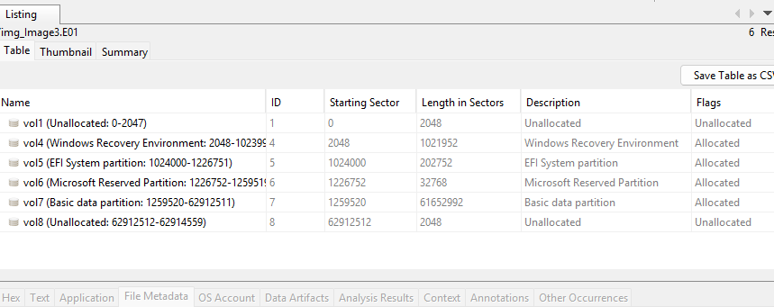
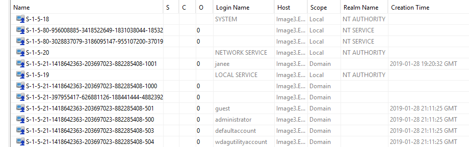
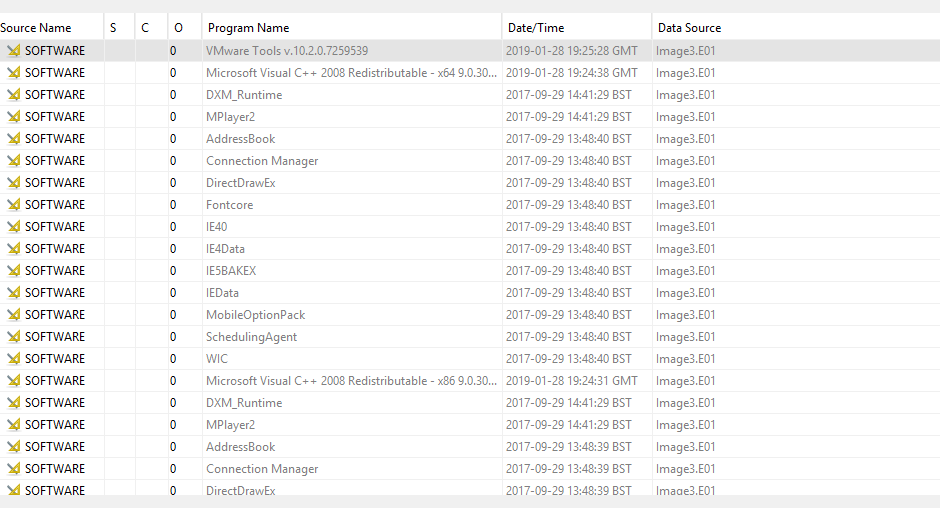
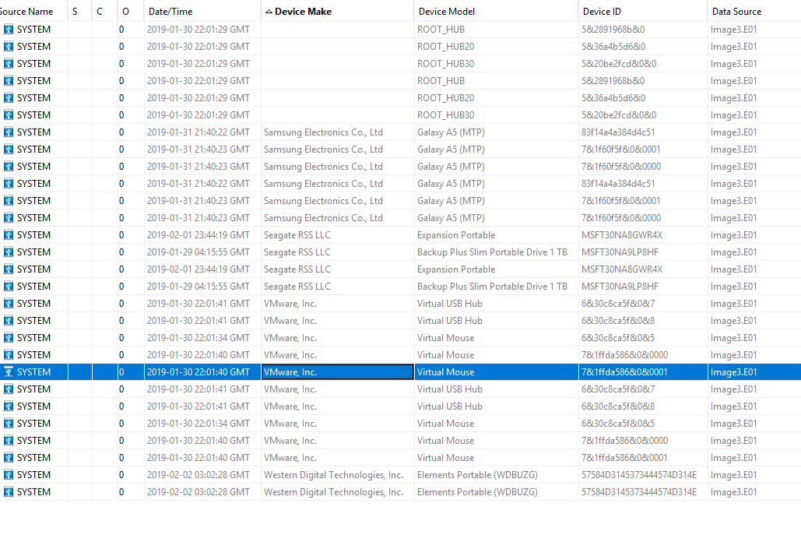

# Digital Forensic Examination of a Disk Image

> Digital-forensics project, 2025.

**Skills shown:** forensic imaging and integrity verification · evidence handling and chain of custody · disk and partition analysis · Windows registry and artefact analysis · USB/device history · timeline and media analysis · forensic reporting

> This write-up describes the **method and the types of evidence recovered**. The specifics of the case (hash values, recovered passwords, suspect identifiers and contact details) are deliberately left out, since the exercise may be reused with current students. The focus here is on technique, not the answer key.

---

## 1. Objective

Examine a forensic disk image of a suspect's computer while preserving forensic integrity, following a repeatable methodology, and documenting every finding so it would stand up to scrutiny.

**Methodology:** acquisition → integrity verification → analysis → reporting (Nelson, Phillips and Steuart, 2019).

---

## 2. Case management and integrity

The investigation used **Autopsy**. Before any analysis:

- The disk image was imported and a **case structure** created to keep the work organised and defensible.
- **Cryptographic hashes (MD5 and SHA-1)** were calculated to verify the image had not been altered, and re-checked afterwards to confirm nothing changed during the examination.
- A **chain of custody** was maintained throughout.

Analysis steps applied: file identification, hash lookup for known-bad files, keyword searching, deleted-file recovery and metadata extraction.

---

## 3. Evidence analysis

### 3.1 Disk structure

Autopsy listed six volumes: four partitions (Windows Recovery Environment, EFI System, Microsoft Reserved and the main Windows data partition) and two small unallocated areas, about 1 MB each, at the start and end of the disk.

Small gaps like these are normal at the start and end of a disk, so they are not suspicious on their own. The unallocated space that matters more is inside the Windows partition, where the contents of deleted files stay until they are overwritten.

### 3.2 System and user

- **OS:** Windows 10 Pro
- **Primary user account** identified from the data partition.
- **Time zone:** Australian Eastern Daylight Time — relevant for building an accurate timeline.
- Fourteen user accounts in total, most of them built-in Windows system accounts (e.g. `LOCAL SERVICE`, `NETWORK SERVICE`, `administrator`, `guest`).

### 3.3 Installed applications

Autopsy listed 58 installed-program entries from the SOFTWARE registry hive. Most were standard Windows components. The notable one was **VMware Tools**, which is installed inside a virtual machine, so the imaged computer was most likely a virtual machine itself. A **remote-access trojan** was also found in the user's Downloads folder — a key pivot point in the investigation, since it was the source of much later evidence.

### 3.4 USB and hardware devices

Autopsy listed **28 USB device records** from the SYSTEM registry hive. Many were duplicates, or internal and virtual devices such as USB root hubs and VMware virtual devices. Four were real external devices: a Samsung phone, two Seagate portable drives and a Western Digital portable drive, connected between late January and early February 2019. This matters because phones and external drives are common ways to move or conceal files.

### 3.5 Media and timeline

Image and document recovery, combined with web-search history and recovered application logs, allowed a timeline of user activity to be reconstructed. File metadata (created/modified/accessed times) was used to order events and corroborate other artefacts.

---

## 4. Reflections and limitations

- The **remote-access trojan** was the turning point: it tied together several otherwise separate artefacts.
- Recovered logs showed evidence of **steganography** (hiding data inside images), which would need dedicated extraction tools to fully analyse.
- Digital forensics is moving toward cloud-based evidence sources (Alenezi, 2023), and a decade-long review of the field highlights the need to keep refining processes against evolving threats (Breitinger et al., 2023).
- **For a stronger case:** additional corroborating evidence and deeper analysis of the steganographic material would help build a clearer, court-ready picture.

---

## References

- Casey, E. (2011) *Digital evidence and computer crime: forensic science, computers, and the internet.* 3rd edn. London: Academic Press.
- Nelson, B., Phillips, A. and Steuart, C. (2019) *Guide to computer forensics and investigations.* 6th edn. Boston: Cengage Learning.
- Alenezi, A.M. (2023) 'Digital forensics in the age of smart environments: a survey of recent advancements and challenges', *arXiv preprint.* https://arxiv.org/abs/2305.09682
- Breitinger, F. et al. (2023) 'DFRWS EU 10-year review and future directions in digital forensic research', *arXiv preprint.* https://arxiv.org/abs/2312.11292
