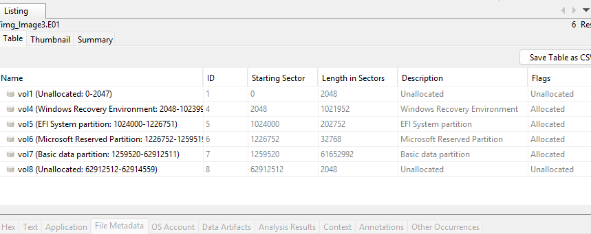
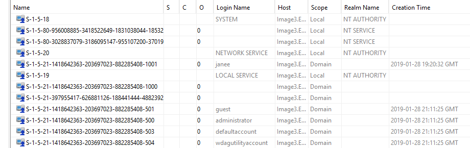
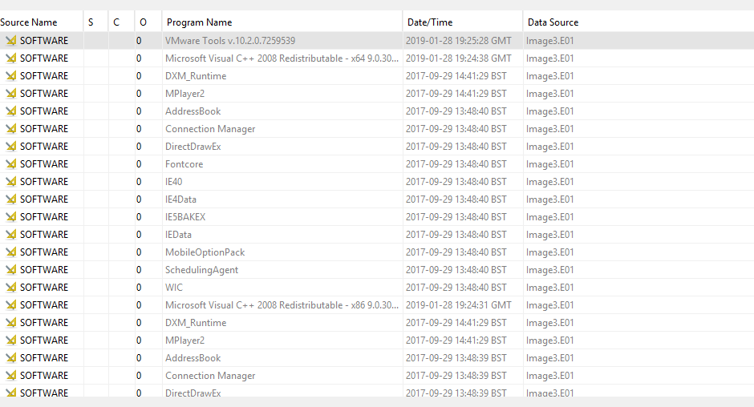
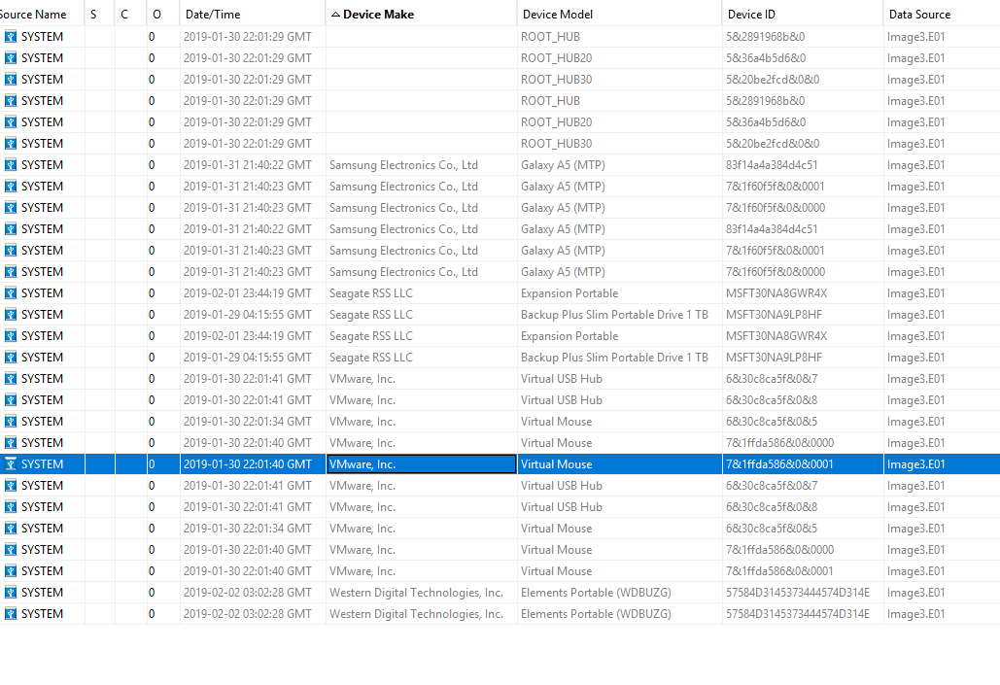

# Digital Forensic Examination of a Disk Image

> MSc Cyber Security coursework, Digital Forensics module, March 2025. Individual work.

**Skills shown:** forensic imaging and integrity verification · evidence handling and chain of custody · disk and partition analysis · Windows registry and artefact analysis · USB/device history · timeline and media analysis · forensic reporting

> This write-up describes the **method and the types of evidence recovered**. The specifics of the case (hash values, recovered passwords, suspect identifiers and contact details) are deliberately left out, since the exercise may be reused with current students. The focus here is on technique, not the answer key.

---

## 1. Objective

Examine a forensic disk image of a suspect's computer while preserving forensic integrity, following a repeatable methodology, and documenting every finding so it would stand up to scrutiny.

**Methodology:** acquisition → integrity verification → analysis → reporting (Nelson, Phillips and Steuart, 2019).

---

## 2. Case management and integrity

The investigation used **Autopsy**. Before any analysis:

- The disk image was imported and a **case structure** created to keep the work organised and defensible.
- **Cryptographic hashes (MD5 and SHA-1)** were calculated to verify the image had not been altered, and re-checked afterwards to confirm nothing changed during the examination.
- A **chain of custody** was maintained throughout.

Analysis steps applied: file identification, hash lookup for known-bad files, keyword searching, deleted-file recovery and metadata extraction.

---

## 3. Evidence analysis

### 3.1 Disk structure

The image contained six partitions, including an EFI system partition, a Microsoft reserved partition and the main Windows data partition, with regions of unallocated space.

The presence of multiple partitions and unallocated space was noted as a possible sign of an attempt to hide data.

### 3.2 System and user

- **OS:** Windows 10 Pro
- **Primary user account** identified from the data partition.
- **Time zone:** Australian Eastern Daylight Time — relevant for building an accurate timeline.
- Fourteen user accounts in total, most of them built-in Windows system accounts (e.g. `LOCAL SERVICE`, `NETWORK SERVICE`, `administrator`, `guest`).

### 3.3 Installed applications

Of 58 installed programs, several stood out: **VMware Tools** (virtualisation, a way to run hidden environments), a media player, and a scheduling agent (possible automation). A **remote-access trojan** was also found in the user's Downloads folder — a key pivot point in the investigation, since it was the source of much later evidence.

### 3.4 USB and hardware devices

System logs recorded **28 external devices**, including Western Digital and Seagate external drives, Samsung phones/tablets, and VMware virtual storage. Timestamps placed the activity in 2018–2019. This matters because external and virtual storage are common ways to move or conceal files.

### 3.5 Media and timeline

Image and document recovery, combined with web-search history and recovered application logs, allowed a timeline of user activity to be reconstructed. File metadata (created/modified/accessed times) was used to order events and corroborate other artefacts.

---

## 4. Reflections and limitations

- The **remote-access trojan** was the turning point: it tied together several otherwise separate artefacts.
- Recovered logs showed evidence of **steganography** (hiding data inside images), which would need dedicated extraction tools to fully analyse.
- Digital forensics is moving toward cloud-based evidence sources (Alenezi, 2023), and a decade-long review of the field highlights the need to keep refining processes against evolving threats (Breitinger et al., 2023).
- **For a stronger case:** additional corroborating evidence and deeper analysis of the steganographic material would help build a clearer, court-ready picture.

---

## References

- Casey, E. (2011) *Digital evidence and computer crime: forensic science, computers, and the internet.* 3rd edn. London: Academic Press.
- Nelson, B., Phillips, A. and Steuart, C. (2019) *Guide to computer forensics and investigations.* 6th edn. Boston: Cengage Learning.
- Alenezi, A.M. (2023) 'Digital forensics in the age of smart environments: a survey of recent advancements and challenges', *arXiv preprint.* https://arxiv.org/abs/2305.09682
- Breitinger, F. et al. (2023) 'DFRWS EU 10-year review and future directions in digital forensic research', *arXiv preprint.* https://arxiv.org/abs/2312.11292
